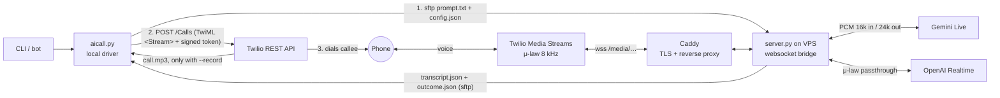

# AI Phone Call Agent ☎️

> Python voice agent for outbound calls using Twilio, Gemini Live and OpenAI Realtime, with Cantonese/English prompts.

**About $0.03–0.04 per minute** for a US call (Twilio + Gemini at list price, no platform fee), against **$0.08–0.38 per minute** on hosted AI calling platforms such as Vapi, Retell, Bland and ElevenLabs. [See the comparison](#cost-compared-with-hosted-platforms).

An AI agent that phones someone for you, holds a natural conversation in Cantonese or English (or any language the model speaks), and hands back a transcript and, if you turn recording on, the call audio.

You give it a phone number and a prompt file ("book a table for 4 on Friday at 8", "confirm tomorrow's appointment"). It dials out through Twilio, streams the call audio to a realtime speech model, lets the model talk and listen with barge-in, hangs up when the model ends the call, and saves `transcript.json` plus a structured `outcome.json` (and `call.mp3` with `--record`).

`aicall.py` is a plain CLI: it can be invoked directly or wired into a bot.

- **Models:** Gemini Live (default `gemini-3.1-flash-live-preview`) or OpenAI Realtime (`gpt-realtime-*`), chosen per call.
- **Small:** one standard-library driver, one websocket bridge, no framework, offline test suite.
- **Output:** timestamped transcript of both sides, an event log (interruptions, end_call, errors) and an outcome (`ok` / `failed` / `no_answer`) that sets the exit code. Audio only when recording is enabled.
- **Sample output:** see [`examples/`](examples/) for a synthetic transcript and console run.

## Cost compared with hosted platforms

**Bottom line (US):** running this repo with Gemini costs roughly a third to a half of the cheapest hosted options (Vapi, ElevenLabs, Retell at about $0.08–0.13/min) and about a quarter of Bland. Against hosted speech-to-speech bundles the gap is larger: Retell charges $0.38/min for GPT Realtime 2, while calling OpenAI Realtime directly through this repo is about $0.07–0.10/min.

With this repo you pay only the carrier and the model, at list price. There is no platform fee and no per-minute markup. Hosted AI calling platforms bundle the same pieces and add their own per-minute charge.

**Running this repo (per conversation minute, US destination):**

| Item | Rate | Source |
|---|---|---|
| Twilio outbound call | $0.0140/min | [Twilio US voice pricing](https://www.twilio.com/en-us/voice/pricing/us) |
| Twilio Media Streams (the audio feed to the bridge) | $0.0044/min | same page |
| Gemini Live, `gemini-3.1-flash-live-preview` | ≈ $0.014–0.023/min | [Gemini API pricing](https://ai.google.dev/gemini-api/docs/pricing): $3 / 1M audio tokens in, $12 / 1M out, 32 tokens per second of audio |
| *or* OpenAI Realtime, `gpt-realtime-2.1` | ≈ $0.048–0.077/min | [OpenAI pricing](https://developers.openai.com/api/docs/pricing): $32 / 1M audio tokens in, $64 / 1M out; 10 tokens/s in, 20 tokens/s out |
| Recording (only with `--record`) | +$0.0025/min | Twilio US voice pricing |

Model estimates assume half of each minute is the callee speaking (audio in) and half is the agent (audio out). The low end bills only the new audio. The high end assumes the re-sent conversation context quadruples the input tokens and is billed uncached; that factor is an assumption, not a published figure.

**Total: about $0.03–0.04/min with Gemini, or $0.07–0.10/min with OpenAI Realtime.** Outside the US the Twilio rate is the part that changes: for example Singapore mobile is $0.0578/min ([SG](https://www.twilio.com/en-us/voice/pricing/sg)) and Hong Kong mobile $0.0546/min ([HK](https://www.twilio.com/en-us/voice/pricing/hk)), so a Gemini call to a Singapore or Hong Kong mobile is about $0.07–0.09/min.

Fixed costs: a Twilio number ($1.15/month for a US local number) and a small VPS for the bridge.

**Hosted platforms (headline outbound rates):**

| Platform | Per minute | What is extra | Monthly / minimum |
|---|---|---|---|
| [Vapi](https://vapi.ai/pricing) | $0.05 platform fee; about $0.08–0.13 all-in in Vapi's own 1,000-minute example | STT, LLM, TTS and telephony billed on top of the $0.05 | Pay as you go; plans from $29/month |
| [Retell AI](https://www.retellai.com/pricing) | $0.07–0.31 (Retell's example: $0.11); speech-to-speech with GPT Realtime 2: $0.38 | LLM, TTS and telephony vary by choice | Number $2/month; extra concurrency $8 per call slot |
| [Bland AI](https://www.bland.ai/pricing) | $0.14 (Start), $0.12 (Build) | Telephony not included | Build plan $299/month |
| [ElevenLabs Agents](https://elevenlabs.io/pricing/agents) | $0.08 | LLM and telephony billed separately | Plans $0–990/month with included minutes |
| [Synthflow](https://synthflow.ai/pricing) | Not published | — | Enterprise contracts from $30,000/year |

What the hosted platforms give you for the difference: a dashboard, inbound calls, phone-number management, high concurrency, call analytics, integrations, compliance tooling and support. This repo is a small CLI and bridge you deploy and maintain yourself.

*Prices checked 2026-10-19 from each provider's public pricing page, in US dollars. They change often, so recheck before you rely on them.*

## Example run

A short (synthetic) run with the demo prompt, abridged from [`examples/sample_console_output.txt`](examples/sample_console_output.txt):

```text
$ python3 aicall.py +12025550100 examples/demo_prompt_en.txt
12:00:09 in-progress
[0.9s] agent: Hi, this is an AI assistant calling from Example Dental Studio. May I speak with Alex?
[6.4s] callee: Yeah, speaking.
[7.6s] agent: Great, thanks! I'm calling to confirm your teeth cleaning on Thursday at 3 pm. Does that still work for you?
[14.2s] callee: Hmm, could we make it a bit later? Like four?
[15.3s] agent: Of course. So you'd prefer Thursday at 4 pm instead. I'll pass that on, and the team will call you back to confirm the new time. Is there anything else?
[24.8s] callee: No, that's all. Thanks.
[25.6s] agent: Thank you, have a great day. Bye!
events [[19.1, 'interrupted'], [28.3, 'end_call'], [30.2, 'twilio stop']]
outcome ok - end_call
```

**Contents:** [Cost vs hosted platforms](#cost-compared-with-hosted-platforms) · [Architecture](#architecture) · [Quick start](#quick-start) · [Usage](#usage) · [Testing](#testing) · [Writing prompts](#writing-prompts) · [Engineering lessons](#engineering-lessons) · [Compliance and ethics](#compliance-and-ethics)

**Docs:** [Deployment guide](docs/deployment.md) (Twilio, VPS, Caddy, SSH, bridge test tool) · [Security and data handling](docs/security.md) (threat model, limits, recording, retention)

---

## Architecture



Bridge-side WAVs (only with `--record`) stay on the VPS; the driver never copies them.

1. `aicall.py` creates a unique call id (`YYYYMMDD_HHMMSS_<12 random hex>`), writes the prompt (plus a short conversation-rules suffix) and `config.json` (voice, model, record flag), and copies both to the VPS under `calls/<call_id>/` through an SFTP-only upload account. Every transfer is checked and time-limited.
2. It creates a Twilio call whose TwiML is `<Connect><Stream url="wss://…/media/<call_id>/<expires>/<token>">`, where `token = HMAC-SHA256(AICALL_SHARED_SECRET, "<call_id>.<expires>")`. The credentials are path segments because Twilio allows no query string in a stream URL. Twilio recording is requested only with `--record`.
3. Twilio opens a websocket to Caddy, which proxies it to `server.py` on `127.0.0.1:8765`.
4. Before the websocket upgrade, `server.py` checks the call id, the token and that the prepared call exists and has not been used yet; anything else gets HTTP 403 and never becomes a websocket. Then it opens a realtime session:
   - **Gemini Live:** μ-law 8 kHz → PCM16 16 kHz up, PCM16 24 kHz → μ-law 8 kHz down (`audioop`).
   - **OpenAI Realtime:** `audio/pcmu` both ways, so Twilio's μ-law passes straight through with no resampling.
5. When the callee talks over the AI, the bridge sends Twilio a `clear` so playback stops at once (barge-in). With OpenAI it also sends `conversation.item.truncate` for the assistant audio in flight, cut at the time that audio has been playing (never more than was sent), so the model does not think the callee heard all of it.
6. The model has one tool, `end_call`. The bridge honours it once the callee has said something and the agent has answered it (see *Ending calls* below), sends Twilio a `mark`, waits until Twilio has finished playing the goodbye, then closes the socket and Twilio hangs up. When the callee hangs up first, Twilio's `stop` ends the call, but the model side gets `TWILIO_STOP_DRAIN_S` (2.5 s) to deliver the callee's last transcription before it is cancelled. Anything the agent says during that drain is dropped, not recorded as spoken: if the callee hangs up before the agent's first word, the outcome is `failed` ("the callee hung up before the agent spoke"). A provider that closes its socket while the callee is still on the line (even with a normal close code) also ends the call as `failed` ("provider closed the session"). After a barge-in, late audio for the item that was cut is discarded. An OpenAI `response.done` with status `failed` (or `incomplete` for any reason except a barge-in), or an `error` event that is not an `invalid_request_error` or a known benign code, ends the call as `failed` with that reason instead of going silent until the time limit.
7. The bridge writes `outcome.json` (`ok`, `failed` or `no_answer`, with a reason), `transcript.json` (and WAVs with `--record`). `aicall.py` polls the call until it ends, fetches both files with bounded retries, exits non-zero unless the outcome is `ok` and, with `--record`, downloads Twilio's recording once it is `completed`.

## Layout

```
aicall.py              local driver: upload prompt, dial, poll, fetch transcript + outcome (+ recording)
server/server.py       VPS bridge: Twilio Media Streams <-> Gemini Live / OpenAI Realtime
tools/fake_twilio.py   simulated Twilio stream for testing the bridge without placing a call
tools/model_bench.py   replays a recorded callee track against several realtime models
prompts/               example prompts with <PLACEHOLDERS> (copy them into prompts.local/)
examples/              synthetic demo prompt, transcript and console output
tests/                 offline pytest suite (no network, no Twilio, no model calls)
deploy/                hardened systemd unit and Caddyfile
docs/                  deployment guide, security and data handling, repository metadata
.env.example           every setting, read from environment variables
```

## Quick start

You need a Twilio account with Voice enabled, a small Linux VPS with a hostname pointing at it, a Gemini API key and, if you want GPT models, an OpenAI API key. The VPS needs Python 3.11+; the driver needs Python 3.11+ and an OpenSSH client (`sftp`). Commands below use `python3` (Linux/macOS); on Windows use `python` or `py`.

### 1. Twilio and the shared secret

Set up a Twilio number and geo permissions, and generate the shared secret: [deployment guide, steps 1–2](docs/deployment.md#1-twilio).

### 2. VPS bridge

Install the bridge as a hardened systemd service behind Caddy, and give the driver an SFTP-only upload account: [deployment guide, steps 3–5](docs/deployment.md#3-vps-bridge). At the end, `curl -s https://your-domain.example/healthz` prints `ok` and `echo pwd | sftp -b - -o BatchMode=yes aicall-upload@your-domain.example` prints `Remote working directory: /`.

### 3. Local driver

`aicall.py` needs only the Python standard library plus `sftp`.

```bash
git clone https://github.com/degenyang/ai-phone-call-agent.git ai-phone-call-agent && cd ai-phone-call-agent
cp .env.example .env && chmod 600 .env
nano .env                  # edit before loading it, see below
set -a; . ./.env; set +a   # load the settings into this shell
python3 aicall.py --help
```

In `.env`, set at least:

- `TWILIO_ACCOUNT_SID`, `TWILIO_FROM_NUMBER` (and optionally `TWILIO_VERIFIED_CALLER_ID`)
- `TWILIO_API_KEY` and `TWILIO_API_SECRET` (preferred), or `TWILIO_AUTH_TOKEN`. A Twilio API key (`SK…`, created under *Account → API keys & tokens*) is preferable to the master auth token: it can be revoked on its own without rotating the account's token, and a Standard key cannot manage API keys or account settings.
- `PUBLIC_WSS_URL=wss://your-domain.example/media`
- `AICALL_VPS_SSH=aicall-upload@your-domain.example` and `AICALL_REMOTE_DIR=/` (the upload account's jail)
- `AICALL_SHARED_SECRET`: the same value as on the VPS
- `AICALL_MAX_CALL_SECONDS`: the same value as on the VPS (default 900)

The VPS-only entries (`GEMINI_API_KEY`, `OPENAI_API_KEY`, `AICALL_MAX_CONCURRENT_CALLS`) can stay as placeholders locally. Load `.env` again in every new shell before running `aicall.py`.

## Usage

First call: your own phone, with the fully synthetic demo prompt.

```bash
python3 aicall.py +<your number> examples/demo_prompt_en.txt
```

Your own prompts belong in `prompts.local/`, which git ignores, so names and phone numbers never end up in a commit. Call artifacts go to `calls/` (also ignored); if you set `AICALL_OUT_DIR` to another folder inside the repository, add it to `.gitignore` as well. `aicall.py` prints a warning when the output folder is inside the repository but not ignored.

```bash
mkdir -p prompts.local
cp prompts/restaurant_booking_yue.txt prompts.local/my_booking.txt   # then replace every <PLACEHOLDER>
python3 aicall.py +<number> prompts.local/my_booking.txt --voice Aoede --limit 300
python3 aicall.py +<number> prompts.local/my_booking.txt --model gpt-realtime-2.1 --voice marin
python3 aicall.py +<number> prompts.local/my_booking.txt --record     # only with the callee's consent
python3 aicall.py --resume calls/<call_id>                             # fetch results again later
```

| Flag | Default | Meaning |
|---|---|---|
| `--voice` | `Aoede` | Gemini prebuilt voice, or an OpenAI voice name for `gpt-*` models (anything else falls back to `marin`) |
| `--model` | `gemini-3.1-flash-live-preview` | any Gemini Live model, or any model starting with `gpt-` for OpenAI Realtime |
| `--limit` | `300` | hard call time limit in seconds (Twilio `TimeLimit`); refused before dialling if it exceeds `AICALL_MAX_CALL_SECONDS`, or 540 for a Gemini model |
| `--from` | auto | caller ID; overrides the automatic choice described under *Anti-spoofing caller ID* |
| `--record` / `--no-record` | off (`AICALL_RECORD`) | record audio: Twilio dual-channel recording **and** bridge-side WAVs; Twilio first says "This call may be recorded." and the prompt asks the agent to mention it too |
| `--chat` / `--no-chat` | off | ask the agent for a minute or two of friendly small talk before saying goodbye |
| `--resume CALL_DIR` | | re-poll and fetch the transcript (and recording) of an earlier call from its `call.json` |

The script prints call status changes, then the transcript, the event log, the outcome and the path of `calls/<call_id>/` (`call.json`, `prompt.txt`, `config.json`, `transcript.json`, `outcome.json`, plus `call.mp3` with `--record`). It never downloads a recording that has not completed.

**Outcome and exit codes.** The bridge records how the model session went in `outcome.json`, e.g. `{"status": "failed", "reason": "session error ...", "secs": 3.1, "model": "..."}`:

| Exit code | When |
|---|---|
| `0` | the call connected and the outcome is `ok` (the model spoke, the callee said something, no session error) |
| `1` | the call did not connect (busy, no answer, failed), the outcome is `failed` (provider or network error, the model never produced audio, or the bridge refused the call) or `no_answer` (nobody said anything), or a setup error before anything was dialled, including a 4xx from Twilio on the dial request (the call was refused, not placed) |
| `2` | the call was placed but its results are not available yet: Twilio could not be reached after retries (the call may still be live), the transcript is not there yet, or the recording is not completed or failed to download; retry with `--resume` |
| `3` | the dial request got no usable answer from Twilio (timeout, connection reset, a 5xx status, or a success response without a call sid), or `--resume` found no readable `call.json` (missing or corrupt), so the call may or may not have been placed; check the Twilio call log before calling again |

`1` means no conversation took place; `2` means the result is unknown, so a bot must not redial on `2` or `3`. Once the call exists, network or Twilio API errors retry with backoff and then give `2`, never `1`. When the bridge refuses an authenticated call without starting a model session (bridge at capacity, unreadable call files, an expired token, no valid `start` event), it still writes `outcome.json` with `"status": "failed"` and the reason, so the driver reports a definite failure instead of waiting for results that will never come.

**Call length vs. token lifetime.** `--limit` is Twilio's `TimeLimit` for the call. Independently, the bridge ends every model session after `AICALL_MAX_CALL_SECONDS` (default 900 s), so the driver refuses a `--limit` above that value (read from the same variable in your local `.env`) before anything is uploaded or dialled. Gemini calls have a lower, fixed cap of 540 s (9 minutes): a Gemini Live connection lasts about 10 minutes before the server ends it, and the bridge does not resume sessions, so it ends Gemini calls at 540 s and the driver refuses a longer `--limit` for Gemini models. To allow longer calls with an OpenAI model, raise `AICALL_MAX_CALL_SECONDS` on both sides. The stream token only has to be valid when Twilio opens the media stream, so it expires a fixed 10 minutes after the call is placed (covering queueing and ringing), whatever the call length; the bridge rejects tokens with a lifetime over an hour.

**Recording and privacy.** Recording is off unless you pass `--record` (or set `AICALL_RECORD=1`); then Twilio records the call and says a fixed "This call may be recorded." before the AI is connected, the bridge keeps WAVs on the VPS and the agent mentions the recording as well. Transcripts are saved on every call, and the audio is always streamed to the model provider. What is stored where, file permissions and how to delete a call: [security.md](docs/security.md#recording-transcripts-and-retention).

## Testing

Use a virtual environment for the tests and the tools; `aicall.py` itself does not need one.

```bash
python3 -m venv .venv
. .venv/bin/activate              # Windows: .venv\Scripts\activate
python3 -m pip install -r requirements-dev.txt
python3 -m pytest
```

The suite is offline: Twilio, SSH and the model providers are faked, and the only socket it opens is a websocket server on `127.0.0.1`. It covers path traversal, invalid / expired / replayed tokens refused with HTTP 403 before the websocket upgrade, the per-call Twilio signature, unique call ids for overlapping calls, recording opt-out (no `Record` parameter, no audio files), missing transcripts and incomplete recordings, session outcomes and exit codes, the end-call state logic (including transcription that arrives after the agent's reply, and an interrupted goodbye), connection/duration/message limits, task cleanup on timeout, `--limit` validation, the tools' WAV validation and the HTTP health check. The provider adapters (`run_gemini`, `run_openai`) run against scripted fakes of the Gemini SDK and the OpenAI websocket: configuration rejection, delayed transcription, interruptions, `end_call` tool calls and cancellation. GitHub Actions runs it on every push (`.github/workflows/ci.yml`).

To exercise a deployed bridge without placing a phone call, see [Testing the bridge without a phone call](docs/deployment.md#testing-the-bridge-without-a-phone-call).

### Comparing models

From the same virtual environment:

```bash
GEMINI_API_KEY=... python3 tools/model_bench.py callee_8k.wav prompt.txt \
    gemini-3.1-flash-live-preview <other-live-model> ...
```

It replays a recorded callee track (a mono 16-bit 8 kHz `callee_8k.wav` from a `--record` call; other formats are refused) into each model and prints what the model heard and what it said back. That is the fastest way to find out which model actually understands your language on an 8 kHz phone line.

## Writing prompts

The examples in `prompts/` follow rules that came out of real calls:

- **Say it is an AI in the first line.** For example: "Hi, I'm an AI assistant calling on behalf of …".
- **One question per turn**, then stop and wait for the answer.
- **Respond to what the callee actually said before moving on.** A prompt like "whatever they answer, say goodbye" makes the model ignore jokes and questions. `aicall.py` appends a short, language-neutral rules suffix enforcing this to every prompt (`--chat` adds the optional small-talk rule).
- **When unclear, ask them to repeat.** Never let the model guess what was said.
- **Don't let it claim actions it cannot take.** The agent has no access to booking systems; have it pass requests on ("the team will call you back to confirm") instead of saying something was cancelled or changed.
- **End with a natural goodbye, then `end_call`.** Put anything important early, because callees often hang up early.
- **Handle voicemail:** wait for the beep and leave a minimal callback message (who is calling and a number to call back), without names, dates, booking details or anything else someone with access to the mailbox could hear. Then say bye and call `end_call`. Every example prompt does this.
- **Don't let the model keep score.** Model-generated facts such as scores should be verified independently. Have it repeat each answer back, and check the transcript or recording rather than the model's summary.

## Engineering lessons

**Anti-spoofing caller ID (Singapore).** Under Singapore's anti-scam / anti-spoofing rules, a call that enters the country from overseas but presents a local `+65` caller ID is rejected. Twilio originates the call abroad, so even a `+65` mobile you have verified in Twilio counts as spoofed: the call fails instantly, with no alert. By default `aicall.py` therefore uses the Twilio-owned number for `+65` destinations and your verified number (if set) for other countries. An explicit `--from` bypasses this choice, so don't pass a verified `+65` number with `--from` when calling Singapore. Check Twilio's per-country voice guidelines before calling a new country.

**VAD tuning for noisy lines.** With default voice-activity detection, background noise on a real phone line kept Gemini "listening" for about 25 seconds before it replied. The bridge sets `END_SENSITIVITY_HIGH` and `silence_duration_ms=700` (OpenAI: `server_vad` at 700 ms), which ends turns quickly without cutting people off.

**The silent first turn.** Now and then a realtime session connects but produces no audio at all. The callee hears silence, says "hello?" and hangs up. Some cases lined up with a provider outage; one happened on a healthy model and an identical retry answered in under a second. The bridge sends a hidden kickoff message so the model speaks first, and a session without any model audio is reported as outcome `failed`. A server-side guard (re-send the kickoff or reconnect if there is no audio within ~3 s) would be the next improvement.

**Ending calls: turns, not keywords.** In simulated calls an OpenAI realtime model called `end_call` right after its first line. A first fix accepted `end_call` only if a goodbye word appeared in recent transcript turns, but that matched either speaker and even "please don't say bye yet". A second version waited for the callee's transcription and then for more agent audio, but the callee's transcription often arrives *after* the agent has already started (or finished) its reply, so a finished exchange still looked unfinished. The bridge now tracks turns for both providers: agent turns end on turn-complete / response-done / interruption, OpenAI's `speech_started` marks where each callee turn began (its late transcript is matched by item id), and for Gemini, words transcribed while a later agent turn is playing count as what that turn answers. `end_call` is honoured only once an agent turn that started after the callee spoke has produced audio. Otherwise the tool call is answered with "not hung up yet, keep talking, say a natural goodbye before calling end_call", and the conversation continues.

**The model's own transcript is not ground truth.** Realtime models mis-hear names and slang in their input transcription. For an accurate record (with consent), record the call and transcribe the callee channel of `call.mp3` with a separate speech-to-text model.

**A transcript is not success.** Early versions exited 0 whenever a transcript came back, even one that held only a provider error. The bridge now writes an explicit outcome, and the driver's exit code follows it, so scripts and bots can tell a failed session from a real conversation.

**Pull less, sooner.** Transferring large WAV files back to the local machine can be slow and stall the driver. The driver pulls only `transcript.json` and `outcome.json` (and with `--record` Twilio's `call.mp3`); the WAVs stay on the VPS. Call metadata goes into `calls/<call_id>/call.json`, so if the local process dies mid-call, the call keeps going on Twilio and `--resume` fetches the results afterwards.

### Model notes for Cantonese (Oct 2026)

**Qualitative observations, not a benchmark.** They come from a small number of real test calls and a few replays of recorded callee tracks with `tools/model_bench.py`, judged by listening and reading transcripts. No per-model call counts, error rates or latency measurements were recorded, so treat these as anecdotes and re-run `model_bench.py` on your own audio before choosing a model. Model IDs are given exactly where they were recorded; where they were not, the entry says so.

| Model | Exact ID | Observation |
|---|---|---|
| Gemini 3.1 Flash Live (preview) | `gemini-3.1-flash-live-preview` | Understood colloquial Hong Kong Cantonese, slang included, best and gave the most natural replies. Chosen as the default. |
| A newer Gemini Live preview | not recorded | Mis-heard much more of one real call; during a provider outage it either errored on connect or connected and stayed silent. |
| Gemini 2.5 native-audio | not recorded | Stayed silent on the replayed audio. |
| OpenAI Realtime | `gpt-realtime-2.1` (input transcription: `gpt-realtime-whisper`) | Followed multi-step prompt rules well (e.g. not revealing a riddle's answer until the callee gave up), but needed the end-call guard above. |
| Whisper → LLM → TTS pipeline (no native speech-to-speech) | not recorded | Turned Cantonese into Mandarin, dropped slang, had no Cantonese TTS voice and added noticeable latency (roughly 2–3 s by ear, not measured). Not usable for conversation. |

## Compliance and ethics

Placing automated calls is regulated, and the rules differ by country. You are responsible for following them.

- **Say it is an AI**, at the start of every call. Every example prompt does this.
- **Consent:** only call people who would expect or welcome the call. Do not use this for cold calling, marketing, debt collection or anything that would need do-not-call registry checks, unless you have done that compliance work.
- **Recording:** call recording requires consent in many places, sometimes from everyone on the call. Recording is off unless you pass `--record`, which also plays a fixed spoken notice before the AI joins and makes the agent mention it. See [security.md](docs/security.md#recording-transcripts-and-retention) for what is stored and how to delete it.
- **Local telecom rules:** caller ID rules (like Singapore's anti-spoofing rule), robocall laws and calling-hour limits apply to you, not to Twilio.
- **Content:** don't use it to harass, impersonate a real person, collect personal or payment data, or prank people who did not agree to it.

## Credits

- [Twilio Programmable Voice and Media Streams](https://www.twilio.com/docs/voice/media-streams)
- [Gemini Live API](https://ai.google.dev/gemini-api/docs/live) (`google-genai`)
- [OpenAI Realtime API](https://platform.openai.com/docs/guides/realtime)
- [Caddy](https://caddyserver.com), [websockets](https://github.com/python-websockets/websockets)

MIT licensed. See [LICENSE](LICENSE).
